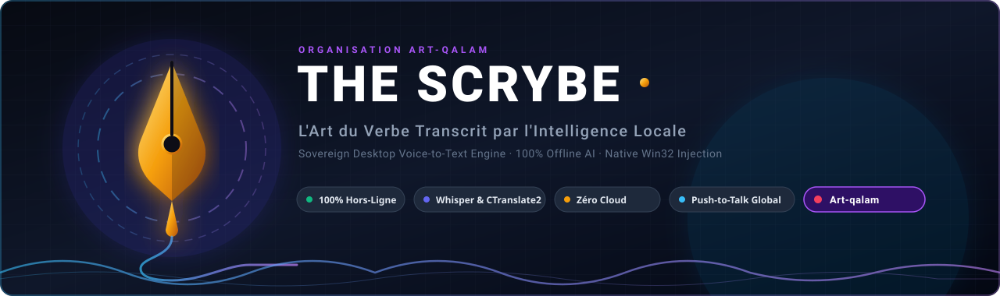

<!-- markdownlint-disable MD013 MD033 -->
# The Scrybe - Assistant de Dictée Vocale

<p align="center">
  
</p>

The Scrybe est une application de bureau de dictée vocale hors-ligne, construite avec Electron et React, avec un backend Python pour la reconnaissance vocale par intelligence artificielle.

## 🎯 Objectif du Projet

The Scrybe offre une expérience de dictée vocale privée et sécurisée, fonctionnant entièrement localement sur votre machine. Pas d'envoi de données vers des serveurs externes, pas de connexion internet requise - juste une transcription vocale précise et instantanée.

## ✨ Fonctionnalités Principales

### 🎙️ Enregistrement et Transcription

- **Enregistrement vocal** de haute qualité avec périphériques audio multiples
- **Transcription locale** avec OpenAI Whisper (modèles : tiny, base, small, medium, large)
- **Support multilingue** : Français, Anglais, Espagnol, Allemand, Italien, Japonais, Chinois
- **Injection automatique** du texte transcrit dans l'application active

### ⌨️ Raccourcis Clavier

- **Push-to-Talk** : Maintenir les touches pour enregistrer, relâcher pour transcrire
- **Push-to-Block** : Mode alternatif d'enregistrement
- **Personnalisation** des raccourcis selon vos préférences

### 🎨 Personnalisation Avancée

- **10 thèmes prédéfinis** : Glass, Light Frost, Dark Glass, Frosted, Blue Haze, Mint, Amber, Violet, Teal, Sunset
- **Personnalisation complète** : couleur de fond, opacité, flou, bordures, coins arrondis
- **Widget flottant** pour accès rapide
- **Mode transparent** avec effets de flou

### 💾 Gestion des Données

- **Historique local** des transcriptions avec timestamps
- **Base de données SQLite** pour stockage persistant
- **Suppression sélective** des entrées

### 🔧 Intégration Système

- **Menu tray** dans la barre système
- **Intégration bureau** : clic droit sur le bureau pour ouvrir l'application
- **Démarrage automatique** avec Windows
- **Instance unique** pour éviter les doublons

## 🏗️ Architecture Technique

### Frontend (React + Vite)

```text
frontend/
├── src/
│   ├── App.jsx          # Composant principal
│   ├── Widget.jsx       # Widget flottant
│   ├── translations.js  # Internationalisation
│   └── assets/          # Images et styles
├── electron/
│   ├── main.cjs         # Processus principal Electron
│   └── preload.cjs      # Script de préchargement
└── package.json         # Dépendances Node.js
```

### Backend (Python Flask)

```text
backend/
├── flask_api.py         # API REST
├── backend_logic.py     # Logique métier
├── audio_recorder.py    # Enregistrement audio
├── speech_recognizer.py # Reconnaissance vocale
├── database_manager.py  # Gestion BDD SQLite
├── text_injector.py     # Injection de texte
├── hotkey_manager.py    # Gestion raccourcis
└── requirements.txt     # Dépendances Python
```

## 🚀 Installation

### Prérequis

- **Windows 10/11** (application optimisée pour Windows)
- **Python 3.8+** installé localement
- **Node.js 18+** pour le développement
- **Microphone** pour enregistrement vocal

### Installation Pas à Pas

1. **Cloner le dépôt**

   ```bash
   git clone https://github.com/ArchNext/The-Scrybe.git
   cd The-scrybe-Electron
   ```

2. **Installer l'environnement virtuel Python**

   ```bash
   python -m venv .venv
   .venv\Scripts\activate
   ```

3. **Installer les dépendances Python**

   ```bash
   cd backend
   pip install -r requirements.txt
   cd ..
   ```

4. **Installer les dépendances Node.js**

   ```bash
   cd frontend
   npm install
   cd ..
   ```

5. **Démarrer l'application**

   ```bash
   cd frontend
   npm start
   ```

### Pour les Utilisateurs Finaux

1. Téléchargez la dernière version depuis la section [Releases](https://github.com/ArchNext/The-Scrybe/releases)
2. Exécutez `The-Scrybe-Setup.exe`
3. Suivez l'assistant d'installation
4. L'application se lancera automatiquement et s'intégrera à votre système

## 🎮 Utilisation

### Première Utilisation

1. **Lancez The Scrybe** depuis le menu démarrer ou le tray système
2. **Configurez votre micro** dans les paramètres si nécessaire
3. **Choisissez votre langue** de transcription
4. **Sélectionnez la qualité** du modèle (recommandé : `small` pour équilibre vitesse/précision)
5. **Testez l'enregistrement** avec le bouton principal

### Modes d'Enregistrement

#### Mode Manuel

- Cliquez sur le bouton 🎙️ pour commencer l'enregistrement
- Cliquez à nouveau pour arrêter et transcrire

#### Mode Push-to-Talk

- Maintenez `Ctrl + Alt` (par défaut) pour enregistrer
- Relâchez pour transcrire automatiquement

#### Mode Push-to-Block

- Maintenez `Ctrl + Shift` (par défaut) pour enregistrer
- Relâchez pour transcrire

### Personnalisation

1. **Thèmes** : Allez dans l'onglet `Apparence` pour choisir parmi 10 thèmes
2. **Couleurs** : Personnalisez la couleur de fond, l'opacité et les effets
3. **Raccourcis** : Modifiez les combinaisons de touches dans `Paramètres`
4. **Widget** : Activez le widget flottant pour accès rapide

## ⚙️ Configuration

### Qualité de Transcription

- **Tiny** : Ultra-rapide, basique (~30MB)
- **Base** : Rapide, correct (~75MB)
- **Small** : Équilibré, recommandé (~250MB)
- **Medium** : Précis, lent (~770MB)
- **Large** : Maximum précision, très lent (~1550MB)

### Paramètres Avancés

- **Périphérique audio** : Sélectionnez votre micro préféré
- **Langue UI** : Choisissez entre Français et Anglais
- **Démarrage automatique** : Lancez avec Windows
- **Intégration bureau** : Clic droit sur le bureau

## 🔧 Développement

### Structure des Scripts

- `npm run dev` : Serveur de développement React
- `npm run build` : Build de production
- `npm run electron` : Lance Electron seul
- `npm start` : Lance application complète (dev + electron)

### API Backend

L'API REST fonctionne sur `http://localhost:5000/api` :

- `GET /status` : État actuel de l'application
- `POST /toggle_recording` : Démarrer/arrêter enregistrement
- `GET /history` : Historique des transcriptions
- `POST /settings/quality` : Changer qualité du modèle
- `POST /settings/language` : Changer langue
- `POST /shortcuts` : Mettre à jour raccourcis

### Variables d'Environnement

- `PORT=5000` : Port du backend Flask
- `PYTHONIOENCODING=utf-8` : Encodage Python
- `SCRYBE_OPEN_SETTINGS=1` : Ouvre directement les paramètres

## 🐛 Dépannage

### Problèmes Communs

#### "Le backend ne démarre pas"

- Vérifiez que Python est install correctement installé
- Assurez-vous que `.venv/Scripts/python.exe` existe
- Consultez les logs dans la console développeur

#### "La transcription ne fonctionne pas"

- Vérifiez que votre microphone fonctionne
- Essayez de changer de périphérique audio
- Testez avec un modèle plus petit (tiny/base)

#### "L'application ne s'installe pas"

- Désactivez temporairement l'antivirus
- Exécutez en tant qu'administrateur
- Vérifiez l'espace disque disponible

#### "Les raccourcis ne fonctionnent pas"

- Vérifiez qu'ils n'entrent pas en conflit avec d'autres applications
- Réinitialisez aux paramètres par défaut
- Redémarrez l'application

### Logs et Debug

- **Frontend** : F12 → Console pour les erreurs JavaScript
- **Backend** : Console Electron pour les logs Python
- **Logs système** : `logs/` à la racine du projet

## 🤝 Contribuer

Les contributions sont les bienvenues !

1. Fork le projet
2. Créez une branche (`git checkout -b feature/nouvelle-fonctionnalite`)
3. Commitez vos changements (`git commit -am 'Ajout nouvelle fonctionnalité'`)
4. Pushez vers la branche (`git push origin feature/nouvelle-fonctionnalite`)
5. Ouvrez une Pull Request

### Convention de Code

- **JavaScript** : ESLint configuration (voir `.eslintrc.js`)
- **Python** : PEP 8 standard
- **Français prioritaire** dans les commentaires et commit messages

## 📄 Licence

Ce projet est sous licence MIT - voir [LICENSE](LICENSE) pour détails.

## 🙏 Remerciements

- **OpenAI** pour le modèle Whisper
- **Electron** pour l'infrastructure desktop
- **React** pour l'interface utilisateur
- **Flask** pour l'API backend
- **Vite** pour le build tool ultra-rapide

## ☕ Soutenir le projet

The Scrybe est gratuit et source-available (licence [PolyForm Noncommercial](LICENSE) : usage non commercial libre) — aucune donnée vendue, aucune collectée. — aucune donnée vendue, aucune collectée. Les dons financent ce qui coûte vraiment :

| Poste | Coût |
| --- | --- |
| 🖋️ Signature du code (SmartScreen) | ~200 €/an |
| 🧪 Tests & matériel | Ponctuel |
| 🛠️ Développement & support | Du temps |

<p align="center">
  <a href="https://www.paypal.com/donate/?business=GL7NR4F2YHUN2&no_recurring=0&currency_code=EUR">
    
  </a>
</p>

Chaque don, même petit, a un impact direct — et reste totalement facultatif.

## 📞 Support

- 📧 Email : [support@thescrybe.app](mailto:support@thescrybe.app)
- 🐛 Issues : [GitHub Issues](https://github.com/ArchNext/The-Scrybe/issues)
- 💬 Discussions : [GitHub Discussions](https://github.com/ArchNext/The-Scrybe/discussions)

---

**The Scrybe** - Votre voix, transcrite instantanément, en toute confidentialité.

## 📜 Licence

Code source disponible sous **PolyForm Noncommercial 1.0.0** — voir [LICENSE](LICENSE).
Usage personnel, éducatif et non commercial libre. Toute exploitation
commerciale nécessite un accord distinct avec Art Qalam.
Composants tiers : [THIRD_PARTY_NOTICES.md](THIRD_PARTY_NOTICES.md).
