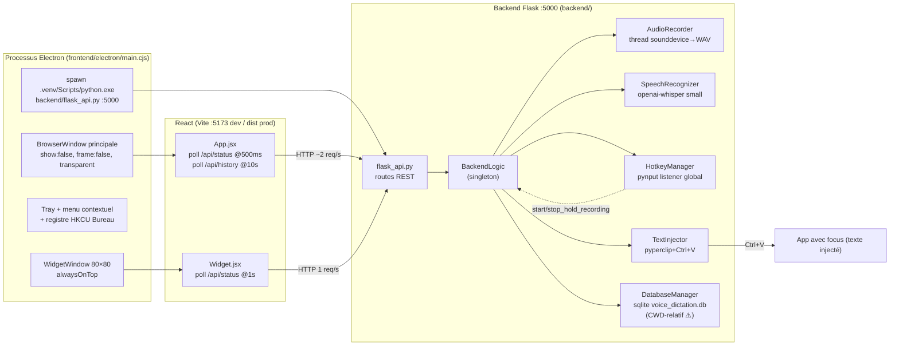
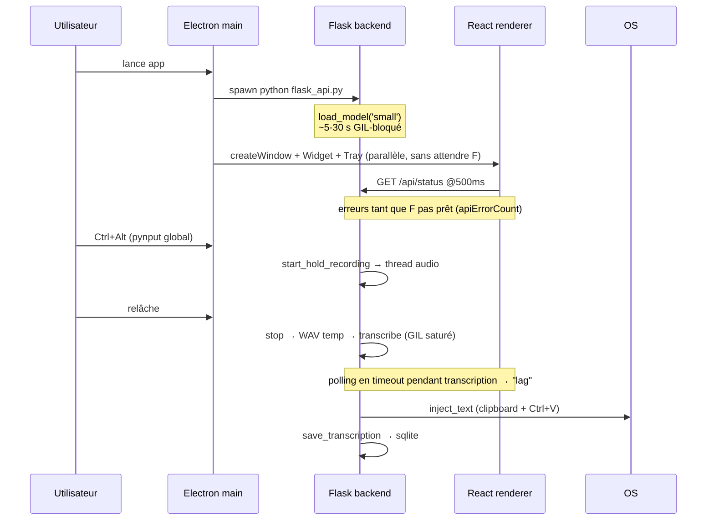

# 02 — Architecture réelle

## Vue d'ensemble

## Choix d'architecture constatés

### Ce qui est bien fait

- **Preload minimal** (`preload.cjs`) : `contextIsolation:true`, `nodeIntegration:false`, surface IPC réduite à 6 méthodes
- **SQL bindé** partout dans `database_manager.py` — pas d'injection
- **Bind loopback** : Flask sur `127.0.0.1` (`flask_api.py:119`)
- **Single instance** Electron (`main.cjs:9-30`) + fenêtre hide-on-close = modèle "app résidente tray" cohérent
- **Threads daemon** pour transcription → l'API reste nominalement responsive

### Ce qui n'est pas bien fait

- **Bypass Electron** : le renderer parle HTTP à Flask ; Electron ne fait que spawner Python — pas de supervision, pas de healthcheck, pas d'IPC unifié
- **Backend lancé à deux endroits** : `main.cjs:301` **et** les scripts `.bat` → doublon port 5000 (B2)
- **DB en chemin relatif** → fragmentée selon le CWD de lancement (B3)
- **Polling plutôt qu'événementiel** : 3 timers HTTP permanents (P1)
- **`BackendLogic` god object** avec référence circulaire `HotkeyManager.app`
- **Apparence persistée côté backend** : préférences d'affichage dans SQLite derrière Flask → synchronisation fragile (lock 3 s `App.jsx:111`)

## Dépendances réelles vs déclarées

| Utilisé | Déclaré `requirements.txt` | Écart |
|---------|---------------------------|-------|
| sounddevice | ✅ | ok |
| openai-whisper + torch | ✅ | ok |
| flask, flask-cors | ✅ | ok |
| pynput, pyautogui, pycaw, comtypes | ✅ | ok (pycaw/comtypes importés nulle part — à vérifier) |
| **pyperclip** | ❌ **absent** | `text_injector.py:2` l'importe — crash si manquant |
| pyaudio | ✅ déclaré | **jamais importé** — install lourd inutile |
| **faster-whisper** | ❌ absent | requis par `speech_recognizer_optimized.py` (non branché) |

## Cycle de vie processus

